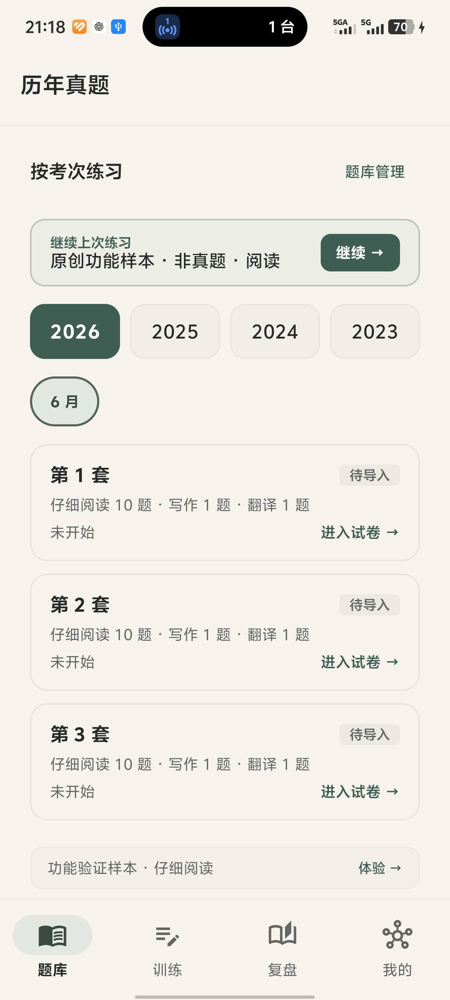
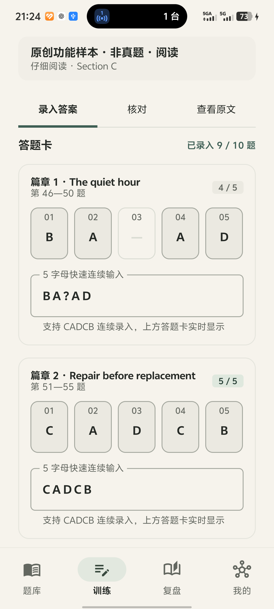
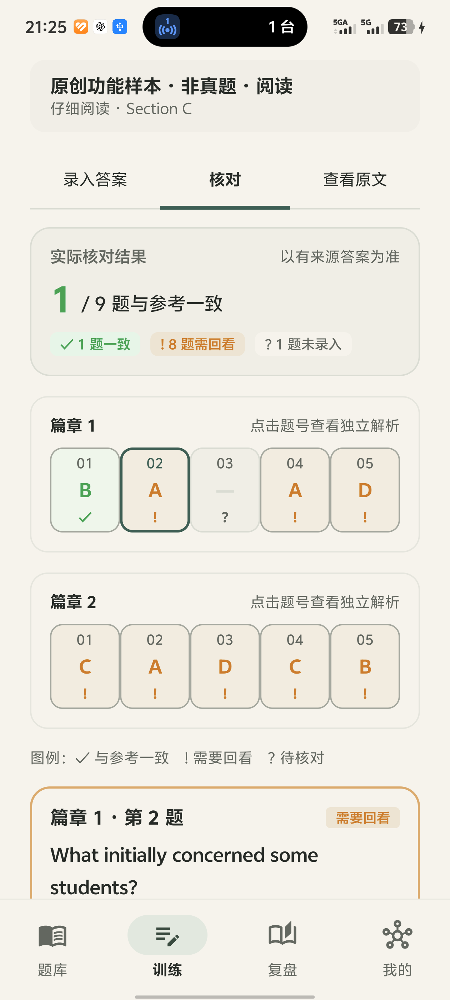
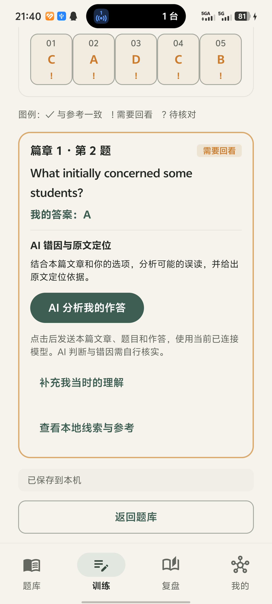

# CET6Study 真机 UI 与 AI 错因诊断验收（2026-10-18）

本轮从实际连接的 vivo V2359A / Android 16 操作和截图，未把模拟器当作真机。经用户明确授权，最终在手机完成一次原创样本真实分析与一次追问，并验证引文所在段落、落盘和冷启动恢复。

## 版本、安装与保全

- 本地及 fetch 后 origin/master：`93944405bf6fd534e9cda0ea06eb5eb8a4c4c995`。在原工作区执行，无 pull、切分支、提交、推送或覆盖原工作。
- APK 包名经 aapt 检查为 `com.example.cet6`，code 15 / `0.6.0-paper-ink`；本轮工作为上述提交之上的未提交改动。最终 APK SHA-256：`F430715E0B8EB73B23907A82168FDA0A126D0C517C1D79E85B48802342DDA6C1`。
- 离线构建成功，81 项单测通过，Lint 0 错误 / 7 警告；见 [构建记录](phone-ai-diagnosis-build-20261018.log)。模拟器受控请求与隔离 Room 回归通过，见 [回归记录](phone-ai-diagnosis-isolated-20261018.log)。新回归覆盖 ReadingDiagnosisInstrumentationChecks（真实模型未参与）。
- 使用指定真机 serial 覆盖安装，最终 adb 返回 Success，MainActivity 启动成功。最初一次安装确认未完成导致 INSTALL_FAILED_ABORTED，已通过新鲜 UI/截图确认后重试。实际出现过「授权本次安装」及验证界面，后续为风险确认勾选和「继续安装」；只操作本 App 对应正常流程，没有关闭防护或绕过验证。认证输入未写入项目文件。
- 升级前后快照 SQLite integrity_check 均为 ok、user_version 均为 7；所有原表原行逐字段一致。原有 8 条训练保留，新增 3 条清楚标为原创功能样本的阅读/作文/翻译记录。见 [逐表结果](phone-data-preservation-20261018.log)。没有读取凭证、注销、清库或卸载，没有在日常真机运行仪器测试。

## 实际流程及视觉结果

1. **题库与考次：通过。** 实际切换 2025 / 2023 / 2026、6 月 / 12 月 / 3 月加考，进入第 2 套并返回。浅色/深色目录截图均已查看。目录与底部导航可读，系统栏没有覆盖固定导航。当前真机真实套卷尚未导入，未将目录冒充可做的试卷正文。
2. **资料导入：通过。** 将仓库 tools/exam-sample.json 作为本机原创样本，经系统文件选择器选取、预览、确认保存。明确标为「原创功能样本 · 非真题」。未导入或提交个人真实试卷。
3. **两篇答案录入：通过并修复。** 实际录入 BA?AD / CADCB，保留第 3 空槽。初次自动化误点同名输入标签造成临时超长内容，页面校验拒绝改写已保存答案；更正焦点后第二篇录入成功，重开仍为上述 9/10 答案。默认 360dp 下固定 56dp+间距导致第 5 槽孤立换行，改按物理像素计算 48–56dp 槽宽后，两个五槽均同排完整显示。
4. **单题修改：通过并修复。** 初次截图发现 D 和清除挤出。将说明与选项分行、选项允许换行后，A/B/C/D/清除均可见。实际把第 1 题 B 改为 D，连续输入变 DA?AD，再改回 B，第二篇不受影响。
5. **核对：通过。** 原创样本实际提交 9/10，显示 1 题与参考一致、8 题需回看、1 题未答。未答题保持原位，点击逐题查看，不把未答算错误选项。
6. **本地线索与参考：通过。** 实际查看四层并 4→2 回跳，页面只显示当前层正文，前三层没有显示参考键。按用户后续新需求，这些固定线索已改为默认收起的可选内容。
7. **AI 主入口：UI、受控回归及两次原创样本真实请求通过。** 新版直接提供 AI 分析我的作答；可补充当时理解、围绕保存分析追问。请求含当前篇章全文、本篇题目/作答与聚焦题来源，不含另一篇章；提示词要求具体错项对比、可能误读、题干→段落同义表达→证据→正确选项的对应关系。完整反馈按题保存，断流保留旧反馈；AI 不改参考键或自动确认错因。原文匹配引文可展开所在段落并突出引文，未匹配文本提示核实。受控回归及单测验证了传参/隔离/保存/保全和匹配逻辑。后续用户明确授权的真实请求见下方补验，不将单一样本泛化为所有模型输出质量保证。
8. **作文与翻译：页面检查通过。** 原创样本空稿输入区、字数、禁用提交与保存入口可见。作文较长题干下按钮接近首屏下边缘，滚动可访问；未改动、提交或请求批改。未验证超长作答的所有输入法场景。
9. **滚动、返回与输入法：已检查。** 阅读输入焦点可保持在键盘上方，隐藏键盘后核对与保存可访问；实际页面切换、返回、滚动及重开恢复成功。键盘显示时底部操作可能需滚动或收起键盘，不宣称始终首屏可见。
10. **深色与可访问性：有限检查。** 实际切换系统夜间模式并恢复原来的 no。中文与导航可读，但深色核对的绿/橙状态字在浅底上仍有对比度风险，尚未测量色值或做 TalkBack/大字体完整验收；不宣称无障碍合规。

## 本轮截图

均为本轮 ADB 原始截图，保存后已查看；01–08 是修复前或中间状态，不能用名称里的 final 代替最终验收。09 之后为布局修正后的验证图；旧四层截图是在新的 AI 主入口需求提出前拍摄，23 为当前 AI 入口。

| 页面 | 截图 |
| --- | --- |
| 浅色题库 | [06](phone-20261018-06-library-final.png) |
| 最终两篇录入 | [09](phone-20261018-09-input-verified.png) |
| 单题修改 | [10](phone-20261018-10-selector-verified.png) |
| 阅读输入法 | [11](phone-20261018-11-ime-verified.png) |
| 核对页 | [12](phone-20261018-12-check-verified.png) |
| 本地四层 | [线索](phone-20261018-13-hint-clue.png) / [定位](phone-20261018-14-hint-location.png) / [证据](phone-20261018-15-hint-evidence.png) / [选项](phone-20261018-16-hint-options.png) |
| 深色核对/题库 | [17](phone-20261018-17-hint-dark.png) / [18](phone-20261018-18-library-dark.png) |
| 长来源修复 | [前](phone-20261018-03-paper-detail.png) / [后](phone-20261018-19-source-fixed.png) |
| 写作/翻译 | [21](phone-20261018-21-writing.png) / [22](phone-20261018-22-translation.png) |
| 当前 AI 主入口 | [23](phone-20261018-23-ai-entry-final.png) |

## 用户授权后的真实 AI 补验

- 用户回复“允许测试”后，在同一 vivo、同一原创样本篇章 1 第 2 题（内部题号 47）完成恰好两次请求，模型为 gpt-6.1-sol。两次均正常保存完整结果，未再请求或自动重试。
- 首次回答实际分析文章主旨、A. The cost of books 的证据缺失，并将可能的误读与用户真实想法区分。给出 initially concerned → initially worried → that 从句 → reduce opportunities to collaborate → C. Fewer opportunities to collaborate 的定位路径，未把学生担忧等同于事实。见 [首次完整回答](phone-ai-first-response-20261018.md)。
- 点击“查看原文第 1 段”后完整段落可读，真实引用突出显示；两份回答的完整引文均逐字匹配仓库原创原文，段号为 1。
- 一次追问补充“I chose A because a library needs books…”。真实回答明确解释“图书馆需要书”不能推出“学生担忧费用”，结合补充重新指导原文定位。见 [追问完整回答](phone-ai-followup-response-20261018.md)。
- 冷启动后在档案重开同一记录，显示已保存的最新追问回答；数据库仍保留首次完整回答，恰好两个本题诊断段落，原作答和参考快照不变。所有既有学习库原行逐字段保留，完整性 ok；见 [真实请求后保全结果](phone-ai-live-preservation-20261018.log)。

| 真机补验截图 | 文件 |
| --- | --- |
| 真实分析及文章结构 | [24](phone-20261018-24-ai-live-analysis.png) |
| 错项原因与具体定位路径 | [25](phone-20261018-25-ai-live-reason.png) |
| 原文展开过程 / 完整段落和引文突出 | [26](phone-20261018-26-live-original-match.png) / [27](phone-20261018-27-live-original-paragraph.png) |
| 冷启动后真实追问回答 | [28](phone-20261018-28-live-followup-reopened.png) |

## 剩余验证边界

只验证了一套原创样本及两次模型请求，不保证所有模型输出；未验证所有长题干、大字体、TalkBack、真实网络异常和令牌到期刷新。未操作用户未完成的真实试卷。授权约定已写入 AGENTS.md，后续仍尊重系统强制验证和执行环境审批。
